# Nami, from scratch: architecture with flowcharts

This document explains the whole system in order: what it is, the pieces, how one request becomes a finished task, how
secrets are kept away from models, how access is collected and revoked, and where the limits are. Diagrams are
[Mermaid](https://mermaid.js.org/) and render on GitHub and in most Markdown viewers.

Contents
1. [What Nami is](#1-what-nami-is)
2. [The system on one page](#2-the-system-on-one-page)
3. [Code map](#3-code-map)
4. [One task, start to finish](#4-one-task-start-to-finish)
5. [Deciding how to get in: the access plan](#5-deciding-how-to-get-in-the-access-plan)
6. [The vault and the path of a secret](#6-the-vault-and-the-path-of-a-secret)
7. [Collecting access from the user](#7-collecting-access-from-the-user)
8. [The API-key route and how a key is sent](#8-the-api-key-route-and-how-a-key-is-sent)
9. [Approvals](#9-approvals)
10. [Sessions, reuse and revocation](#10-sessions-reuse-and-revocation)
11. [Safety layers](#11-safety-layers)
12. [When things go wrong](#12-when-things-go-wrong)
13. [Memory, caching and learned workflows](#13-memory-caching-and-learned-workflows)
14. [Data stores](#14-data-stores)
    - [Several tasks at once, and Slack](#14b-several-tasks-at-once-and-slack)
15. [Deployment shape](#15-deployment-shape)
16. [Observability and tests](#16-observability-and-tests)
17. [What it can do, what it cannot](#17-what-it-can-do-what-it-cannot)

---

## 1. What Nami is

Nami is a chat assistant that completes tasks on websites. The user writes a request in plain language ("check my credits
on OpenRouter", "list my Canva files", "order dinner on Swiggy"). Nami works out which site and which kind of access is
needed, asks only for what is missing, does the work in a **background browser** (or through an API key, or Google's
APIs), checks the result on the page, and answers in chat.

Three promises shape every design choice:

| Promise | How it is kept |
|---|---|
| **Secrets never enter chat or a model's input.** | A vault holds them; models only ever see placeholder names; typed secrets are refused by a filter and scrubbed from saved chat. |
| **The user stays in control of anything risky.** | Purchases, sends, spending credits and similar steps always stop at an approval card the user sees. |
| **Access is reusable and revocable.** | Logins, API keys, 2FA keys and sessions are saved once, reused across tasks, and removable with one click (which also signs the user out). |

Signing in to the app itself is Google-only (Chainlit OAuth).

---

## 2. The system on one page

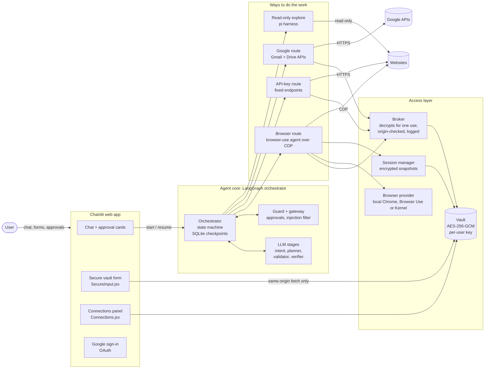

Reading the picture: the **orchestrator** decides; the **routes** act; the **access layer** is the only code that ever
touches a secret; the **web app** is where the user talks, approves and enters secrets (secrets go to the vault directly,
not through the chat path).

---

## 3. Code map

```
app/
  main.py, cl_app.py          FastAPI + Chainlit entry; chat handlers, approval cards, scrubbing of saved chat
  slack/                      Slack bot (Socket Mode, DM only): linking, progress message with a Stop button, approvals, concurrent jobs
  core/                       config, container (services), runtime (builds everything once), LLM clients, cleanup
  agent/
    graph.py                  the Orchestrator: every node of the task state machine
    intent.py                 stage 1: read the request (user text only)
    access_planner.py         plain-code decision of how to get in (no model)
    planner.py                stage 3: turn the goal into subgoals
    validator.py, verifier.py check each step on the page; verify the whole task
    guard.py                  which steps need approval; backstop on risky pages
    google_runner.py          Gmail/Drive work through Google's APIs
    suggest.py, context.py    next-step suggestions, context trimming
  browser/
    executor.py               runs one subgoal with browser-use over CDP
    broker.py                 hands placeholders (never values) to the agent; decrypts for one use
    provider.py, local_provider.py, browser_use_provider.py, kernel_provider.py   browser lifecycle; one profile writer per user, extra browsers are scratch
    session_manager.py, snapshots.py    saved sessions, restore, revoke
    api_executor.py, api_auth.py        server-side calls with a saved API key; how the key is sent
    live_relay.py, live_router.py       optional live view for a one-time secure sign-in window
  vault/                      crypto, KMS, origins, service, router (REST for the form and panel), activity feed
  security/                   secrets filter, gateway (injection layers), capabilities, identity tokens, authz
  connect/                    "Connect Google" OAuth flow, Google API client, revoke at Google
  sites/                      registry.yaml (per-site hints, API blocks), loader, approval policy
  rules/                      org/user/site policies (allowed sites, spend limit, approvals)
  tenancy/                    users, orgs, roles
  memory/                     short-term (conversation), long-term (facts), embeddings
  cache/                      exact and semantic caches (Redis optional)
  skills/                     learned, signed, scanned workflows
  harness/                    pi read-only exploration (tool server + runner)
  eval/                       golden tasks, fake site, replay, calibration
  db/                         SQLAlchemy models, async engine, per-tenant scoping
public/elements/              SecureInput.jsx, Connections.jsx, ApprovalCard, LiveBrowserView
migrations/                   Alembic
tests/, scripts/              unit and integration tests; scripted end-to-end smoke checks
```

---

## 4. One task, start to finish

The orchestrator is a LangGraph state machine. Each node does one job and names the next. All state is checkpointed to
SQLite, so a task can pause for the user (an approval, a code, a login) and resume later, even after a server restart.

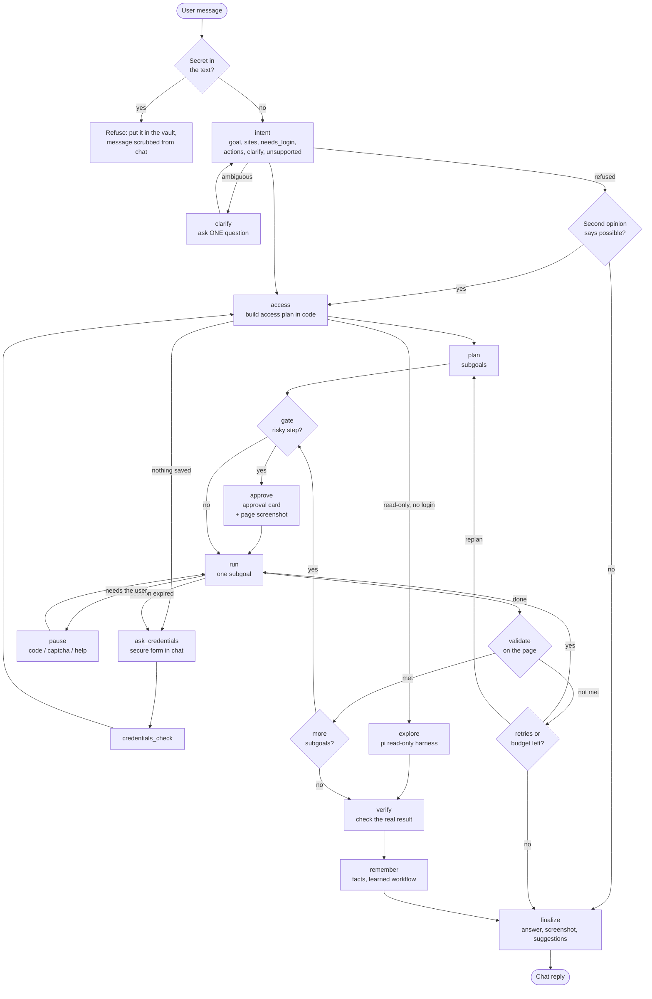

### Stage by stage

| # | Stage | Input | Output | What it cannot see |
|---|---|---|---|---|
| 0 | Secret filter | the raw message | pass or refuse | n/a (pure code) |
| 1 | `intent` | user's words, redacted history, recalled memories | goal, sites, `needs_login`, `actions`, one clarify question | any web page |
| 2 | `access` | intent, saved credentials, rules | an **access plan** | any web page (plain code, no model) |
| 3 | `plan` | goal + access plan + approved workflows | 1 to 10 subgoals with success criteria | secrets |
| 4 | `gate` | next subgoal | continue, or approval needed | n/a |
| 5 | `run` | subgoal + placeholders | the page work | secret values (only placeholders) |
| 6 | `validate` | page text (redacted) and screenshot | met or not met | secrets; sign-in steps get text only, no screenshot |
| 7 | `verify` | collected evidence, final page | verified result and confidence | n/a |
| 8 | `remember` | verified outcome | facts, a candidate workflow | n/a |

A request that matches a cached answer or a trivially read-only lookup can skip stages. Retries and replans are bounded
by a per-task step and time budget (see `app/core/config.py`), so a task cannot loop for ever.

---

## 5. Deciding how to get in: the access plan

The access plan is computed in **plain code from the user's own words and the saved credentials**. No page content and no
model output can add a site to it. This is the main guard against a malicious page steering the agent to another site.

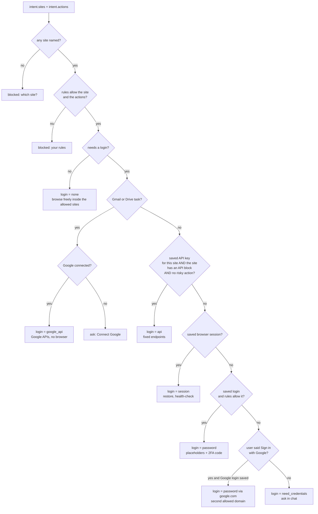

Notes
* A saved credential counts only for the site it is bound to (origin allowlist).
* "Sign in with Google" on another site adds `google.com` as a second allowed domain, still decided from the user's text.
* Sites with phone-and-code logins (Swiggy) work with a saved username and no password; Nami asks for the code in chat.

---

## 6. The vault and the path of a secret

### What is stored and how

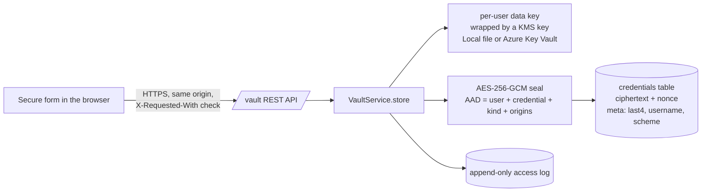

* Kinds: password (username, optional password), API key, TOTP seed, card (demo, not PCI), OAuth grant (Google).
* The AAD binds ciphertext to its owner, kind and origins, so a copied row cannot be replayed for another user or site.
* `meta` holds display facts only (last four characters, username, which header an API key uses), never a secret.
* Revoking wipes the ciphertext (the row stays, empty, for the log). Deleting the account destroys the user's key.

### The path of a secret during a task

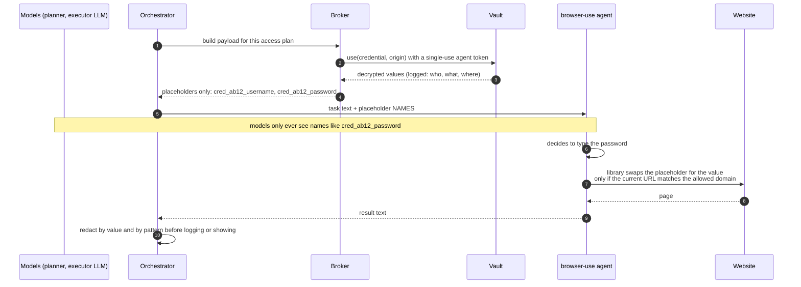

Details
* **Substitution happens inside the browser-use library** (`sensitive_data`), per domain: a placeholder is replaced only when
  the current page's domain matches the key it was registered under. A different site gets the literal name, not the value.
* **2FA**: the TOTP seed is opened only inside the vault, which returns just the current code (never the seed) under a name that
  does not end in `bu_2fa_code`, so the library does not derive its own. Non-standard TOTP settings work the same way.
* **One-time codes** the user types in chat (SMS/email) are held in memory for a short time, never in state, database or events.
* Every decrypt needs a **single-use, short-lived agent token** (ES256) scoped to one credential; replays are rejected.
* Every API request made with a key is also logged (host, method, path, status; no query, no body, no key).

---

## 7. Collecting access from the user

When nothing usable is saved, Nami asks in chat instead of opening a browser for the user to watch.

```mermaid
flowchart TD
    N[access plan: need_credentials] --> CARD[Chat card: reason + secure form<br/>kinds offered depend on the site]
    CARD --> USER{User}
    USER -->|fills the form| SAVE[Vault stores it<br/>never touches chat or a model]
    SAVE --> ADDED[clicks I've added it]
    ADDED --> RECHECK[credentials_check re-reads the vault]
    RECHECK -->|usable for THIS site| CONT[continue the same task<br/>nothing lost]
    RECHECK -->|nothing new or wrong site| AGAIN[explain what is missing, ask again<br/>bounded retries]
    USER -->|Sign in once| ONCE[one secure live window<br/>only on request]
    USER -->|cancel| STOP[task cancelled]

    CONT --> RUN[sign in with placeholders]
    RUN -->|site sends a code| CODE[ask in chat: what is the code?<br/>kept in memory only]
    RUN -->|captcha / passkey| OFFER[offer one-time secure window]
    RUN -->|rejected login| UPDATE[ask for an updated login]
```

* **Forms**: password (with optional 2FA key or QR image read on the device), API key, TOTP key, card.
* **Google (Gmail, Drive)**: a "Connect Google" OAuth link; the refresh token goes straight into the vault.
* **Other sites**: password, or "Sign in with Google" using the saved Google login.
* **Honest edges**: CAPTCHA and passkeys cannot be automated; Nami says so and offers the single secure window.

---

## 8. The API-key route and how a key is sent

If a site has an `api:` block in `app/sites/registry.yaml` and the user saved an API key for it, Nami skips the browser:
the model picks an endpoint **name** from a fixed list; the URL, method and body are fixed in the registry.

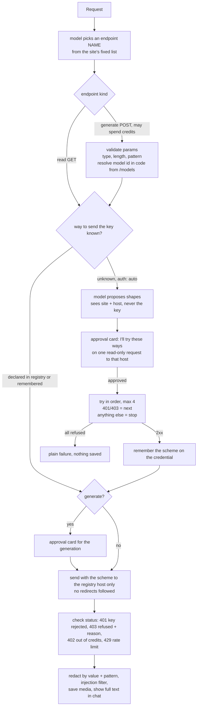

The key can be sent four ways (`app/browser/api_auth.py`): **bearer**, a **named header** (optional prefix and fixed version
headers), **basic auth**, or a **URL parameter**. Every field is validated against a strict pattern, so a model cannot add a
`Host` or `Cookie` header, a second credential or a different host. A way that Nami worked out itself is forgotten if the site
later answers 401, so it is worked out again.

---

## 9. Approvals

Anything that cannot be undone or may cost money stops at a card the user sees. There is deliberately **no HTTP route that
approves anything**; approval is a button in the chat session that owns the task.

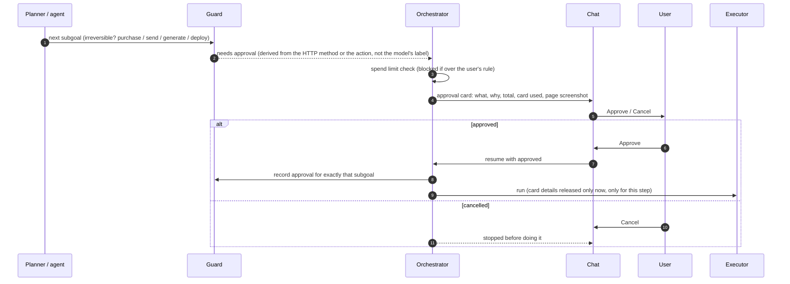

* The executor re-checks the Guard on every step (a **backstop** stops a non-approved step that reaches a payment page).
* The screenshot on the card is the last observed page, held **in memory only**, readable only by the task's owner while the
  approval is pending.
* A saved card is released to the page only for an approved purchase step.

---

## 10. Sessions, reuse and revocation

Reuse is what makes repeat tasks fast: no login, no codes, no questions.

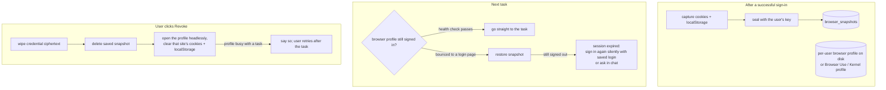

* Two copies of "signed in" exist: the encrypted snapshot **and** the browser profile. Revoking a login or using
  "Sign out and forget" clears **both**, otherwise the site stays signed in.
* The health check opens a per-site page and treats a login redirect or a password box as signed out. A site-specific URL
  check can overrule an unsure validator when a sign-in really worked.
* Disconnecting Google also revokes the grant at Google and drops the saved Google session.

---

## 11. Safety layers

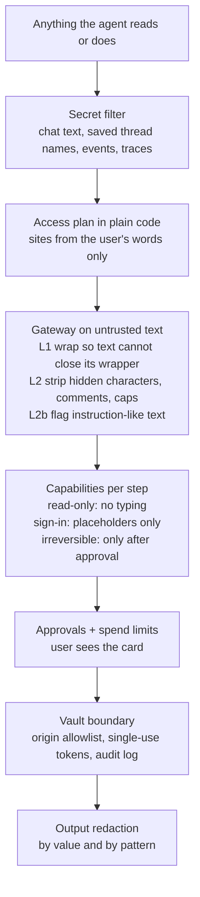

| Threat | Defence |
|---|---|
| User pastes a secret in chat | Filter refuses it before any model call; the saved message and thread name are scrubbed. |
| A web page tells the agent to leak data or go elsewhere | Page text is wrapped, sanitised and screened; the domain allowlist came from the user, not the page; typing is limited to placeholders. |
| A page asks for a credential for another site | Placeholders only expand on the site they are bound to; pending questions are built from the user's site, not the page. |
| Model invents a URL, header or model id | Endpoints and bodies are fixed in the registry; header names are pattern-checked; model ids are resolved in code from the site's own list. |
| Another user's data | Every query is scoped by user and org; roles (a viewer cannot create credentials); vault rows are bound to their owner. |
| A leaked database | Credentials and snapshots are ciphertext; keys are in the KMS, not the database. |
| Over-spending | Spend limit rule, approval for every generation and purchase, free models resolved without credits when asked. |

---

## 12. When things go wrong

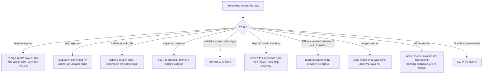

Principles: explain what is needed in plain words; never lose the request; never claim success without checking the page
(or the API response); say "done, but I couldn't fully verify it" when verification is not possible.

---

## 13. Memory, caching and learned workflows

* **Short-term memory**: a window of recent turns, with older turns folded into a summary (redacted).
* **Long-term memory**: facts the user stated (preferences, details), stored with embeddings; recalled into the intent stage
  as *user's own earlier words*. Users can ask to see or delete memories.
* **Caches** (optional Redis): exact and semantic caches for intent results; a refusal is never replayed from the cache.
* **Learned workflows (skills)**: after a verified task, the steps are saved as a *candidate* workflow, scanned for injected
  instructions, judged, and signed. Only approved and signed workflows are given to the planner as guidance; a rejected one is
  never used.

---

## 14. Data stores

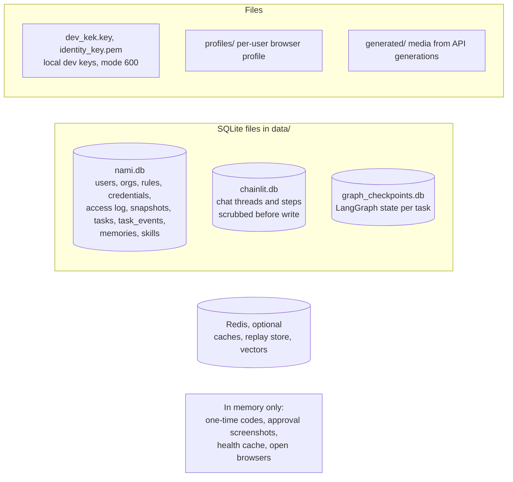

* Task events are the audit record of a task; they carry no secrets and no page text beyond short redacted snippets.
* The browser profile directory holds live cookies and tokens in plain files; treat the machine and the folder as sensitive
  (see the limits section).
* Alembic migrations (`migrations/`) create and evolve `nami.db`.

---

## 14b. Several tasks at once, and Slack

* **Concurrency.** A user can run several tasks at the same time (cap `NAMI_MAX_TASKS_PER_USER`, default 3; a fourth is told to
  wait or stop one). Each task gets its own browser.
* **One profile writer per user.** The first browser opens the user's saved profile. Any further concurrent browser is a
  *scratch* browser with no profile; its logins come back from the encrypted per-site snapshots, and closing it never releases
  the profile. Revoke still uses the plain `open`, so it reports "profile busy" instead of clobbering a running task.
* **Slack.** The bot runs over Socket Mode, in DMs only, and a Slack account is linked automatically by matching the email on its Slack profile to a Nami user (no second sign-in). Each running
  request has its own progress message with a **Stop** button (the button carries a per-run id, so a stale click is refused).
  Stop cancels the run, closes its browser and keeps nothing half-done. A message sent while one is running starts another job
  alongside it ("stop" cancels all of them). Typed secrets are refused here too.
* **Browser Use Cloud.** The provider creates a hosted browser per task through its API and always sends the stop call, because
  closing the CDP connection alone does not stop billing. 429 (too many sessions) and 402 (credits) become clear messages.

---

## 15. Deployment shape

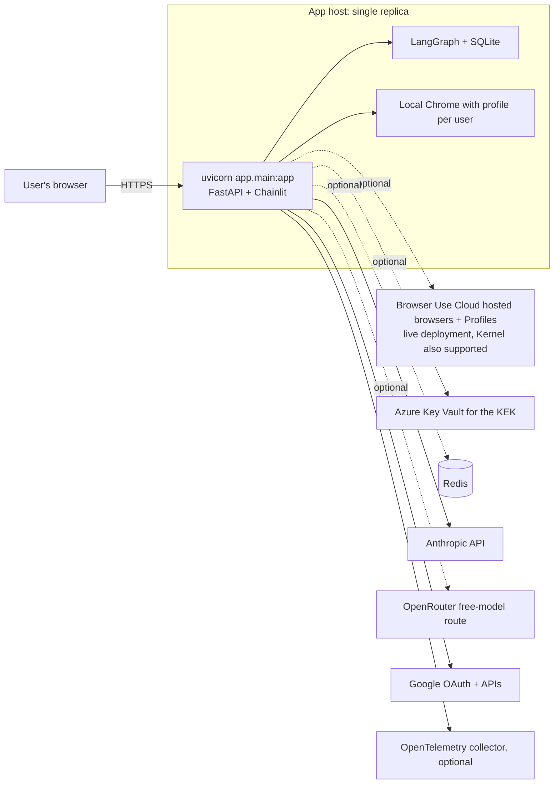

* One process, one replica: the open-browser table, the per-user running-task count and one-time codes are in memory.
* The live deployment is one small Azure VM (Docker + Caddy for HTTPS), secrets in Key Vault read at service start, SQLite
  replicated to Blob by Litestream, no SSH (operations go through `az vm run-command`; see `docs/DEPLOY_AZURE.md`).
* Switch the browser with `NAMI_BROWSER_PROVIDER` (local, browser_use or kernel), the key store with `NAMI_KMS_PROVIDER` (local or azure).
* Start locally: `uv run uvicorn app.main:app --port 8000`.

---

## 16. Observability and tests

* **Tracing**: OpenTelemetry spans per graph node and model call, carrying org, task and a hashed user id. A redaction pass
  runs before any export, and a test checks that no secret, user id or page text appears in a span.
* **Events**: `task_events` records plan, steps, approvals, validations and the final result for each task
  (`GET /tasks/{id}` for the owner).
* **Tests**: unit tests for crypto, vault, origins, TOTP, gateway, capabilities, planner, routers, UI cards; browser tests on real
  Chromium (profiles, snapshots, revoke); scripted end-to-end smoke checks (`scripts/smoke_graph.py`, `smoke_authz.py`,
  `smoke_identity.py`) that run the whole graph with a scripted model and assert, among others, that no secret reaches events,
  spans or prompts. A golden-task harness and calibration scripts live in `app/eval/`.
* **What the tests do not prove**: behaviour on real third-party sites. Registry API paths are marked unverified until called
  live.

---

## 17. What it can do, what it cannot

**Can**
* Do a task on an arbitrary website with a background browser, signing in with a saved login (and a generated 2FA code), a saved
  session, or "Sign in with Google".
* Use an API key server-side for fixed endpoints, including generation (text, image, video, speech) after approval; work out how
  an unfamiliar API wants its key, after approval.
* Read and act on Gmail and Drive through Google's APIs after "Connect Google" (sends need approval).
* Pause for approvals, codes and help, then resume the same task.
* Show what it did and what each saved item was used for; revoke any item, which also signs the user out.

**Cannot, or not shown**
* CAPTCHA, passkeys and hardware keys cannot be automated.
* Up to three tasks per user run in parallel (one browser each), but each task is a single agent; long multi-site research is cut short by the step and time budget. A 1 GB VM can struggle with three heavy tasks at once.
* No guarantee on unfamiliar sites; pages that change, bot detection and unusual flows can still defeat it. The validator is a model and can be wrong.
* The card vault is a demo, not PCI-certified.
* Browser profiles on disk hold live sessions in plain files (outside the vault's encryption); with Browser Use the profile lives in their cloud.
* Whether Browser Use saves a profile when a browser is stopped is unverified; the encrypted snapshots cover that gap.
* API route works only for sites with a registry API block; the registry entries are unverified against live services.
* Request-level limits such as "under 150 INR" are not enforced as hard checks; only the user's spend-limit rule is.
* Single replica; no horizontal scaling (running-task counts and open browsers are in memory).

For the deeper design notes see `docs/ACCESS_MANAGEMENT.md` (credential choices), `docs/HARNESS.md` (read-only exploration),
`docs/LIMITS.md` and `docs/SKIPPED.md` (known gaps).
