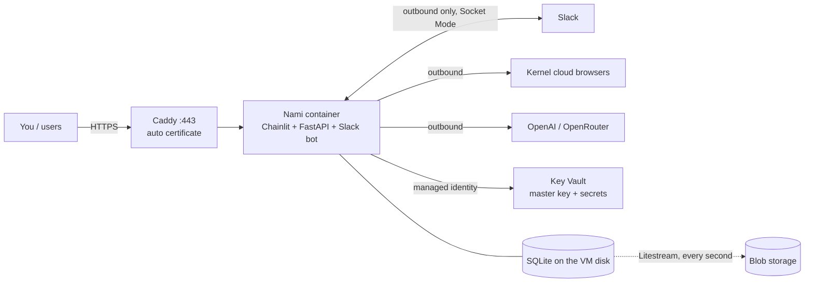

# Deploying Nami (app + Slack bot) on Azure, as cheaply as possible, always on

**Status: a draft. Nothing here has been run, and nothing has been created in your Azure subscription.** The prices and the
size restrictions below were read live (Azure's public price list, and `az vm list-skus` against your subscription on 2026-10-13).
The scripts in `infra/azure-vm/` parse (`sh -n`) but have never executed.

## The recommendation

**One small VM running Docker, with Caddy in front for automatic HTTPS. About $11 a month (roughly ₹900–1,000).**

| Item (Central India, 730 h/month) | $/month |
|---|---|
| VM `Standard_B2ats_v2` (2 vCPU burstable, 1 GB), $0.00615/h | 4.49 |
| Static public IPv4 (Azure now charges for it), $0.005/h | 3.65 |
| OS disk, 30 GB Standard SSD (the E4 size) | 2.64 |
| Blob storage for database backups (a few MB), Key Vault (a few hundred operations), DNS name | ~0.10 |
| **Total** | **≈ 10.9** |
| Not included: OpenAI and Kernel usage, which are separate and depend on how much it is used | |

Your subscription is a sponsored one (`Sponsored_2016-01-01`, spending limit off), so credits probably cover this. I couldn't
see the credit balance from here: check **Cost Management** in the portal.

## Why this and not the alternatives

| Option | $/month | Verdict |
|---|---|---|
| **VM + Docker + Caddy** | **≈ 11** | Cheapest. Always on by nature (nothing deallocates a VM). SQLite on a real local disk. Full control. |
| Container Apps, 1 replica always on (the repo's existing `infra/containerapp.yaml`) | ≈ 19–20 (compute ≈ $14 after the free grant, plus ACR Basic ≈ $5.07) | Works, safer to operate, but nearly double. SQLite lives on ephemeral disk and relies on Litestream restoring it after every restart. |
| App Service Basic B1 (Linux) | ≈ 13.1 | Always On is available, but its persistent storage is a network file share, which is a bad home for SQLite. Not recommended. |
| App Service Free / Functions / scale-to-zero anything | 0 | Not an option: they sleep, or cap CPU minutes per day. The Slack bot needs one process that stays connected. |

Things that look cheaper and aren't: an Azure Container Registry is $5/month, half the whole bill, so the image is shipped to
the VM through Azure instead. A managed database or Redis would each cost more than the VM.

## What I found in your subscription that shapes this

- **Size restrictions.** In Central India only `B2ats_v2` is open to you; `B1s`, `B1ms`, `B2s` and `B2s_v2` are restricted. South India
  and Southeast Asia restrict all of them (including `B2ats_v2`). So this is Central India, and 1 GB of RAM, which is the main
  risk below. (Total regional vCPU quota is 65, which is plenty.)
- **Providers** Compute, Network, KeyVault and Storage are already registered.
- **The CLI** is installed and signed in as your account.

## How it fits together



- **Always on.** `systemd` restarts the stack after a crash or a reboot; Docker restarts containers; the VM has no auto-shutdown.
- **HTTPS with no domain to buy.** Azure gives the public IP a free name, `nami-xxxxxx.centralindia.cloudapp.azure.com`; Caddy gets a
  Let's Encrypt certificate for it. That is also what makes Google sign-in and the Slack link page work.
- **Secrets never touch disk or the repo.** The VM's managed identity reads them from Key Vault at every start and writes them to
  `/run/nami/env`, which is in memory and mode 600. The vault's master key (the KEK that wraps every user's data key) lives in Key
  Vault and never leaves it.
- **The Slack bot** uses Socket Mode, so Slack never calls the VM: no Slack-facing endpoint to expose.
- **Browsers** run on Kernel (no Chrome on the VM). Headful, as set earlier.

### Every feature, in the cloud

| Feature | How it works there |
|---|---|
| Google sign-in | The HTTPS name plus one redirect URI you add in Google Cloud Console |
| Vault (encrypt, origin binding, access log) | Same code; the master key is in Key Vault (`NAMI_KMS_PROVIDER=azure`) |
| Browser tasks, in-page secure window | Kernel; the live view streams over the same HTTPS websocket |
| Slack bot, approvals, code form, add-credentials page | Socket Mode out; the page is served at the public HTTPS name |
| Idle shutdown, retries, memory, skills nightly check | In-process; nothing external |
| Read-only research harness (`pi`, Node) | Already inside the image |
| Database backup | Litestream to Blob (see "Unverified" below) |
| **Semantic cache** | **Off.** It needs Redis; 128 MB more RAM doesn't fit in 1 GB. Everything else is unaffected; repeats of a request just aren't served from cache. |

## Deploy

You need: your Google OAuth client id, and the secrets (OpenAI key, Kernel key, Google client secret, the two Slack tokens).

```sh
az login                                     # already done
GOOGLE_CLIENT_ID=... ADMIN_EMAILS=you@x.com infra/azure-vm/deploy.sh      # ~8 min; prints the address and the Google redirect URI
# add that redirect URI in Google Cloud Console, then:
export KV_NAME=<printed>
for s in openai-api-key kernel-api-key google-client-secret slack-bot-token slack-app-token; do infra/azure-vm/set-secret.sh $s; done
infra/azure-vm/push-image.sh                 # builds the image inside Azure, puts it on the VM, starts it
curl https://<printed address>/healthz
```

`set-secret.sh` asks with hidden input, so nothing lands in your shell history or a process list. Updating the app later is
`push-image.sh` again (about a minute of downtime while it restarts). `remote-start.sh` restarts without rebuilding (after a secret changes).

**Secrets are read when the service starts.** If you add or change one later, run `infra/azure-vm/remote-start.sh` so the app picks it up
(found at deploy time: the app came up once the required secrets existed and was missing the Slack tokens added a minute later).

**There is no SSH.** Found live: this Mac's network blocks or intercepts SSH (a control test to `github.com:22` also gets no banner), so
every operation on the VM goes through `az vm run-command`, which is HTTPS to Azure's management plane. That also lets the firewall keep
port 22 closed. To debug by hand, open it for your address only: `SSH_FROM=<your ip> infra/azure-vm/deploy.sh`, or run commands with
`az vm run-command invoke -g nami-rg -n nami-vm --command-id RunShellScript --scripts '<shell>'`.

**Who can sign in.** The deployment defaults `NAMI_ALLOWED_EMAIL_DOMAINS` to the admin email, so only that Google account can use it (an
empty value would let any Google account in and spend your model credits). Add a person with one command (it restarts the app, about 30 s):

```sh
infra/azure-vm/allow-email.sh someone@gmail.com        # a whole domain also works: example.com
```

There are **two** gates, and both must let the person in:
1. **Nami's allowlist** (the command above).
2. **Google's.** While the OAuth consent screen is in *Testing* (the default for a new project), Google refuses anyone who is not a listed test
   user with "Access blocked: ... has not completed the Google verification process". In Google Cloud Console: **APIs & Services → OAuth consent
   screen → Audience → Test users → Add users**, add their address, Save. (Up to 100 test users.) Publishing the app to "In production" lifts this,
   but for the basic profile/email scopes Nami asks for that needs no verification review; it does show an "unverified app" warning on first sign-in.
   The redirect URI under **Credentials → your OAuth client → Authorized redirect URIs** is separate and set once, not per person:
   `https://nami-3dab10.centralindia.cloudapp.azure.com/chainlit/auth/oauth/google/callback`.

**First checks after it starts:** the address loads and Google sign-in works; `Slack bot connected` in
`sudo docker compose -f /opt/nami/docker-compose.yml logs nami`; DM the bot; run one read-only task and one login task; then
`sudo docker stats --no-stream` to see real memory.

## Risks, said plainly

1. **1 GB of RAM is tight.** The app idles around 115 MB here, but a task adds Playwright's helper process and the `pi` research harness
   (Node), plus Caddy and Docker. The scripts add a 2 GB swap file and a 700 MB container limit so a spike is slow, not a killed
   process. If it still struggles, resize in about a minute with `az vm resize` (it restarts the VM). The sizes your subscription
   allows, and what they cost, are in "If 1 GB is not enough" below.
2. **Burstable CPU.** `B2ats_v2` earns CPU credits and spends them under load (20% baseline per vCPU). This app mostly waits on models
   and remote browsers, so it should be fine; a long CPU-heavy stretch would slow it. Watch the "CPU credits remaining" metric in the portal.
3. **Single machine.** If the VM host fails, it is down until Azure heals it (usually minutes). That is the price of $11. Backups mean
   no data loss, not no downtime.
4. **Kernel limits are not mine to see.** Headful browsers and your Kernel plan decide how many tasks you can run, and a residential
   proxy or region choice needs a paid Kernel plan.
5. **Unverified, so check on first boot:** (a) Litestream's Azure backend with a storage account key. The repo's existing config assumed
   managed identity, which I couldn't confirm for the pinned version, so the script puts the account key in Key Vault and passes it as
   `LITESTREAM_AZURE_ACCOUNT_KEY`. Test it by restoring into a scratch folder before trusting it. (b) That Chainlit builds the Google
   callback with `https` behind Caddy: `FORWARDED_ALLOW_IPS=*` and `CHAINLIT_URL` are set for that, and the first sign-in is the proof.

## If 1 GB is not enough

Checked against your subscription in Central India (70 sizes with up to 4 vCPU and at least 2 GB are open to you). The useful ones,
with the whole monthly bill (VM + IP + disk + backups), same region, same price list:

| Size | RAM | Whole bill | Note |
|---|---|---|---|
| **`B2ats_v2` (the plan)** | 1 GB | **≈ $10.9** | Try this first. |
| `B2als_v2` | 4 GB | ≈ $24.4 | Same family and same x64 image, so the scripts work unchanged. Enough room to also run Redis (semantic cache on). |
| `B2pls_v2` | 4 GB | ≈ $22.7 | Arm CPU: the image would have to be built for `linux/arm64` (`push-image.sh` uses amd64). Not worth the change for $1.7. |
| `B2as_v2` | 8 GB | ≈ $42.3 | Only if you outgrow 4 GB. |

Move up with `SIZE=Standard_B2als_v2 infra/azure-vm/deploy.sh` for a fresh deployment, or on an existing one
`az vm resize -g nami-rg -n nami-vm --size Standard_B2als_v2` (it restarts the VM; the disk, IP and data stay).

One honest point from this: at $24.4, the 4 GB VM costs more than the Container Apps option (≈ $19–20), which gets only 1.25 GB.
So the order is: the $11 machine first; if memory really is the problem, the $24 one; Container Apps only if you value its
managed restarts over the price.

## Security choices

- No SSH port is open at all (operations go through `az vm run-command`); the VM key is only there because Azure requires one.
- Sign-in is limited to the admin email by default.
- Key Vault with purge protection (7-day retention) and RBAC; the VM identity gets only `Secrets User` and `Crypto User`.
- Secrets in memory only on the VM; the image has no secrets; `.env` is excluded from it.
- Ubuntu security updates apply automatically (`unattended-upgrades`).
- Because purge protection is on, deleting the vault leaves its name reserved for 7 days.

## Costs you can control

- Set a budget alert in **Cost Management → Budgets** at, say, $15 so a surprise is an email, not a bill.
- Stop paying for it: `az group delete -n nami-rg` removes everything (the Key Vault name stays reserved for 7 days).
- The public IP is the one line I can't trim: Azure's Standard IPv4 is always a paid static address, and a VM that serves HTTPS needs one.

## Browser Use instead of Kernel

`NAMI_BROWSER_PROVIDER=browser_use` uses Browser Use Cloud's hosted browsers (API v4, India proxy by default: `NAMI_BROWSER_USE_PROXY_COUNTRY`).
Switching a running deployment, without typing the key anywhere but the hidden prompt:

```sh
export KV_NAME=nami-kv-3dab10
infra/azure-vm/set-secret.sh browser-use-api-key              # hidden input
infra/azure-vm/set-env.sh NAMI_BROWSER_PROVIDER=browser_use   # restarts (refused while a task runs)
```

Not verified live (no key was available when it was written): the profile search response and whether Browser Use saves a profile on stop.
Both fail soft: without a profile the saved-login snapshots still sign the user in. Each running task has its own browser, so your
Browser Use plan's concurrent-session limit is the real ceiling (a 429 is reported as "too many browsers open").
