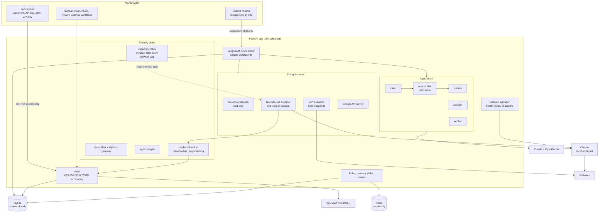
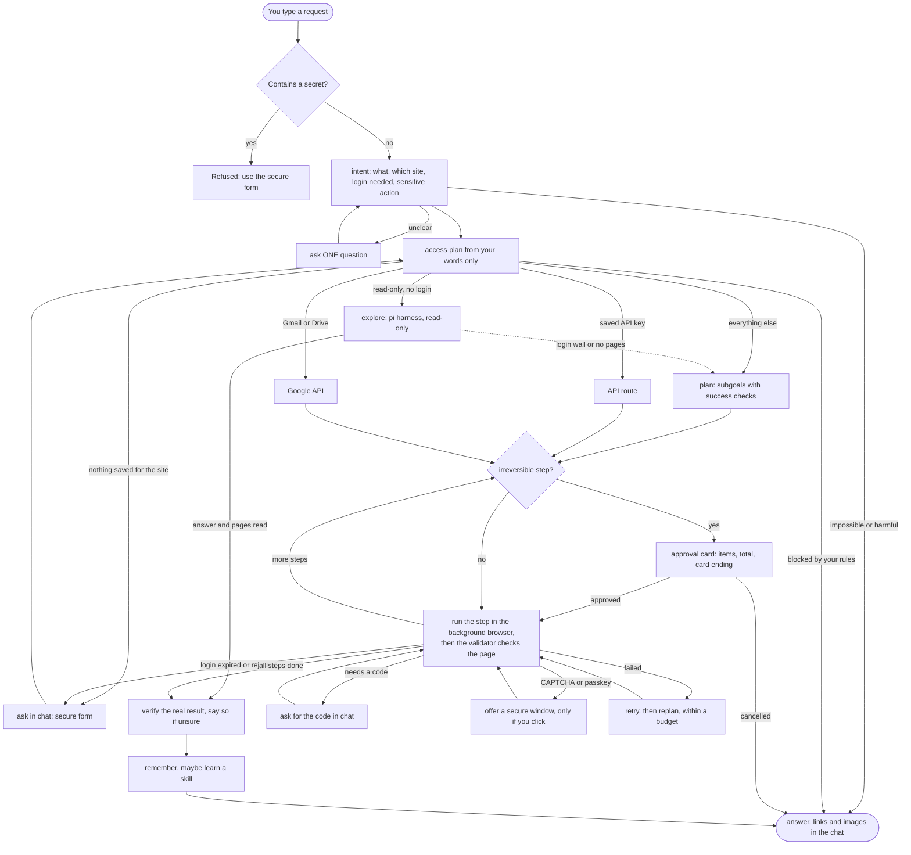
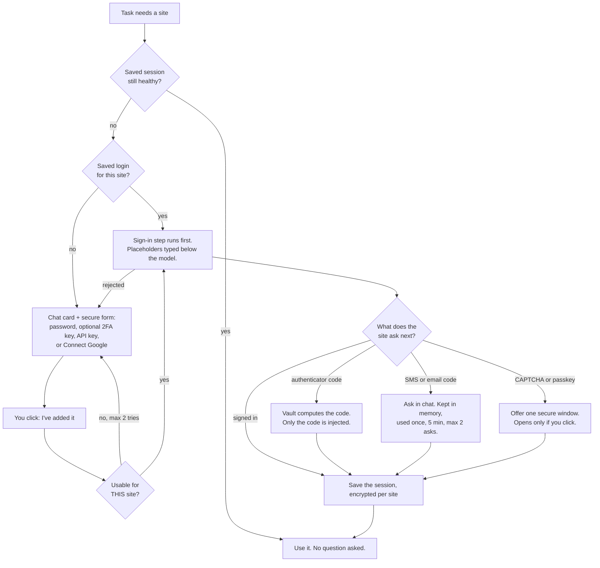
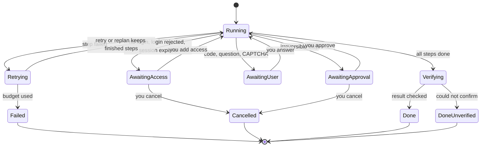

# Nami: how it is built, how a task flows, what it can and cannot do

*Written 2026-10-07. Everything below describes code that exists. "Verified" means I ran it. It does not mean it works on every real website. Diagrams are Mermaid: they render on GitHub and in most editors. The older build spec is `ARCHITECTURE.md` (partly stale), and the long list of unverified items is `SKIPPED.md`.*

---

## 1. What Nami is

A chat assistant that does tasks on websites for you with a **background browser**. You say what you want in plain language. Nami asks only what it must, works without you watching, asks for access in a safe way, and checks the real result before it says "done".

The central rule: **a secret travels only from your browser to the vault.** It never goes through the chat, the model, a log, a cache or an event.

| You want | Nami's answer |
|---|---|
| Plain-language requests | One chat. At most one clarifying question. |
| Secure access | Secure form (not the chat) for password, API key, card, 2FA key. "Connect Google" link for Gmail and Drive. |
| No re-entry | Logins and browser sessions are saved and reused across tasks and fresh browsers. |
| 2FA | Authenticator key given once; Nami generates the codes. SMS or email codes are asked for in chat. |
| Remove access | One click. The ciphertext is wiped and the site's session is cleared. |
| No watching | The browser is headless. Nami posts brief updates and asks for help only when it must. |
| Honest result | A separate verifier checks the actual page. It can say "done, but I couldn't fully verify it". |

---

## 2. The system at a glance

### Components

| Part | Job | Where |
|---|---|---|
| Chat UI | Chainlit on FastAPI. Google OAuth only. Cards for login, approval, result. | `app/cl_app.py`, `public/elements/` |
| Orchestrator | LangGraph graph with SQLite checkpointing. Pause, resume, replan, restart-safe. | `app/agent/graph.py` |
| Intent | Reads your message. Decides: clarify, refuse, or proceed. User text only. | `app/agent/intent.py` |
| Access plan | **Plain code, not a model.** Decides which sites, which saved logins, which approvals, from your words only. | `app/agent/access_planner.py` |
| Planner | Breaks the task into subgoals, each with a success check and a reversible/irreversible flag. | `app/agent/planner.py` |
| Executor | browser-use agent, one run per subgoal. Secrets are placeholders. | `app/browser/executor.py` |
| Validator / Verifier | Validator checks each step. Verifier checks the final result against the real page. | `app/agent/validator.py`, `verifier.py` |
| Vault | Per-user keys, origin allowlist on every decrypt, append-only access log, TOTP. | `app/vault/` |
| Broker | Builds the placeholder map for one task from approved credentials only. | `app/browser/broker.py` |
| Session manager | Saved sessions per (user, site), health check, re-auth. | `app/browser/session_manager.py` |
| Explore harness | Read-only research with a tiny tool set, no vault. | `app/harness/` |
| Tenancy | Users, channels, scoped database access. | `app/tenancy/`, `app/db/scoped.py` |
| Skills | Learned workflows: scanned, judged, signed, hash-pinned. | `app/skills/` |
| Eval | Scripted-model drift harness, replay, calibration. | `app/eval/` |

---

## 3. One task, start to finish

The same graph as the code builds it is in `agent_graph.mmd` and `agent_graph.png`. A more detailed hand-drawn version is `nami_flow.mmd`.

### What each stage can and cannot see

| Stage | Sees | Never sees |
|---|---|---|
| Intent, access plan | Your text | Page content, secrets |
| Planner | Your text, the access plan, site hints | Secret values (placeholders only) |
| Executor model | The page, placeholder names | Secret values |
| Validator | Redacted page text (screenshot too, except on sign-in steps) | Secret values |
| Verifier | Redacted evidence | Secret values |

---

## 4. Getting and keeping access

**What is stored where**

| Thing | Stored as | Used how |
|---|---|---|
| Password | AES-256-GCM, bound to user, credential id and allowed sites | Typed by the browser layer through a placeholder, only on its own site |
| API key | Same, bound to the API host | Used server-side for a fixed list of endpoints. The model picks an endpoint name, never a URL. |
| Card | Same. Only brand, last four and expiry are shown. | Placeholder exists only for the one step you just approved |
| 2FA seed | Same, linked to its password | The vault computes each code. The seed never reaches the agent. |
| SMS / email code | **Not stored.** Memory only, single use. | Typed through a placeholder |
| Browser session | Encrypted snapshot per (user, site) | Restored into a fresh browser; health-checked first |
| Every use | Append-only access log, shown as plain-language Activity | You can read it and revoke from the same panel |

**Revoking.** Revoke wipes the ciphertext. "Sign out and forget" also deletes the site's session snapshot and clears its cookies. Deleting the account destroys the user's key, so everything is unreadable.

---

## 5. Safety layers

```mermaid
flowchart LR
    A["1. Secret filter<br/>on your message"] --> B["2. Access plan<br/>from user text only"]
    B --> C["3. Placeholders<br/>model never sees values"]
    C --> D["4. Origin binding<br/>on every decrypt"]
    D --> E["5. Injection gateway<br/>regex, optional model"]
    E --> F["6. Capability policy<br/>after every browser step"]
    F --> G["7. Approval gate<br/>for irreversible steps"]
    G --> H["8. Redaction<br/>by value, everywhere"]
    H --> I["9. Verify the<br/>real result"]
```

| Layer | What it stops | Limit |
|---|---|---|
| Secret filter | A password or key pasted into chat | Catches common forms, not every possible disguise |
| Access plan | A web page adding a site or a credential to the task | Needs the site to be named in your words or known from the registry |
| Placeholders | The model reading or repeating a secret | The page can still show a secret the site itself displays |
| Origin binding | A credential used on the wrong domain (`swiggy.com.evil.io`) | Registrable-domain match, not full URL |
| Injection gateway | Instructions hidden in page text reaching *my* validator and verifier | It cannot screen what the browser library feeds its own model |
| Capability policy | Off-plan navigation, typing a secret into the wrong place, a submit in a "read-only" step | Stops the **next** step. It cannot undo the last one. A click can send one GET to a third party. |
| Approval gate | Orders, payments, sends, deletes. For APIs it is derived from the HTTP method. | Approval of step 5 never approves step 6 |
| Redaction | A secret value in any prompt, log, event, cache or chat | By exact value, so very short values are not redacted |
| Verifier | Saying "done" when it is not | It is a model judging a page. It can be wrong. |

Other protections: single-use short-lived tokens between parts, tenant scoping on every query, Chrome autofill off and form history wiped in the local browser, a cap on password typing per run, an eval harness that measures leaks and approval adherence with a scripted model.

---

## 6. Resilience: what happens when things go wrong

- The request is a LangGraph thread checkpointed in SQLite. A pause (login, approval, code) keeps it. A server restart resumes it and re-shows the pending card.
- When access expires, Nami explains what is needed, you provide it, and the task continues from where it stopped, not from the start.
- Failed steps retry, then replan. Finished steps are kept. There is a budget.

---

## 7. What Nami can do

Verified live (real model, a local stand-in shop served as `foodco.com`, mock API server, fake credentials, throwaway users):

- Understand a plain request and ask one question only when needed ("order me some food" asked which service).
- Ask for a login in chat with a secure form. No password, TOTP seed, card number or API key was found in the chat, any database, the checkpoint files or the server log.
- Sign in by itself with a saved password and type through placeholders.
- Generate TOTP codes from a standard base32 key, an `otpauth://` link and a non-standard seed.
- Reuse a saved session in a new task and a fresh browser, and sign in silently again after the session is cleared.
- Stop before an irreversible step and show an approval card (items, total, card ending). Nothing was placed before approval.
- Use a saved API key: read credits freely, and make exactly one call to generate text only after approval.
- Resume after a restart, after an expired session, and after a replan without losing the request.
- Revoke a login. The next task asks again.
- Say "Done and checked" or "Done, but I couldn't fully verify it".
- Read the open web with the read-only explore harness, and Gmail/Drive through Google's API once connected.
- Learn a workflow after a verified task, scanned and signed, only as guidance.

## 8. What Nami cannot do (or has not been shown to do)

**Not built**
- Network-level blocking of off-plan requests. A click can send one request to a third party before the policy stops the next step.
- Handling a CAPTCHA, passkey or hardware key by itself. It offers a one-time window and needs you.
- Sharing credentials between users or organisations. Credentials are never shared.
- Payments done safely at production grade. Cards are demo-grade, not PCI. Use a virtual or one-time card in production.
- More than one replica. SQLite and live browser sessions are in memory. A restart ends the live session (the task resumes).

**Not verified against the real thing**
- Real Google consent and "Sign in with Google" sites.
- SMS and email code boxes with a real site, and `request_help` at a real code box.
- Kernel hosted browsers and live view, Azure Key Vault wrapping, Redis-backed replay protection, the container deployment.
- The injection classifier on real pages (off by default).
- A full purchase approve-and-complete through the chat UI: the run reached the real pay-approval card and then the model key hit its usage limit.
- Success rate, cost and speed on real commerce, banking or social sites. These are unmeasured. The numbers above come from a stand-in site and are not success rates.

**Known weaknesses**
- The planner sometimes invents a success criterion the page can never meet. Retries then take about 400 to 600 seconds. A cap is needed.
- The validator passed a wrong answer once. About 3 of 8 successful read runs ended "unverified".
- The browser agent's own page input is not sanitised. The defence there is structural: plan, allowed domains, placeholders, approvals.
- A second message sent while a task runs starts a second run that kills the first run's browser.
- A model-provider error is shown to the user as raw text instead of a plain message.
- A failed sign-in for any cause, even a site that is down, still asks for a new login.
- Approval cards can have thin wording (for example `Clicked a "Checkout"`) and may repeat after a replan.
- A crypto-shred is complete only after backups expire (72 hours). An older backup still holds the wrapped key.
- Storing a password and its 2FA seed together makes them one factor. The UI says so.
- `uv.lock` is stale and the dependency list needs a network `uv lock`.

**Deliberately not done:** no mode without sign-in, no email/password sign-in to Nami itself (Google only), no secret through the chat socket or a UI action.

---

## 9. Tests and how much to trust them

- Suite: 1021 passed, 4 skipped, 0 failed (last full run, reported by the UI-test run; not repeated since).
- `scripts/smoke_graph.py`: 149 checks on the whole graph with a scripted model.
- Eval harness: leaks, approval adherence, recovery under UI drift. Scripted model and a stand-in site only.
- Live runs used the real Claude model against local stand-in sites. They show that flows work and that secrets stay out of storage. They are not a measure of reliability on the real web.
- Mutation habit: break a safety rule on purpose and confirm a test fails. Not repeated for the latest fixes.

## 10. Where to look next

| Question | File |
|---|---|
| Access choices and where they stop | `ACCESS_MANAGEMENT.md` |
| The pi explore harness | `HARNESS.md` |
| Every unverified item and defect | `SKIPPED.md` |
| Short limits list | `LIMITS.md` |
| Original build spec and decisions | `ARCHITECTURE.md` |
| Graph as built | `agent_graph.mmd`, `agent_graph.png` |
